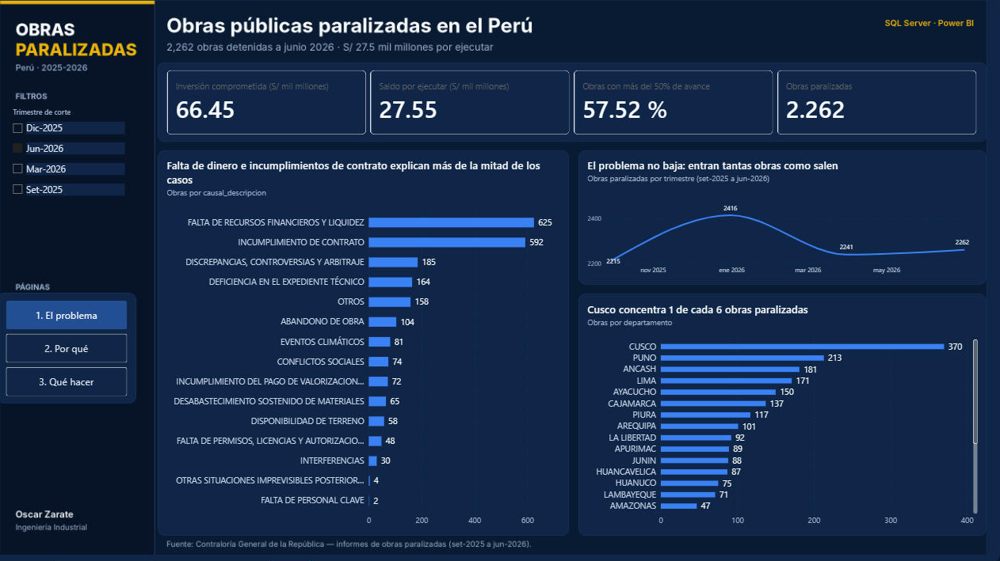
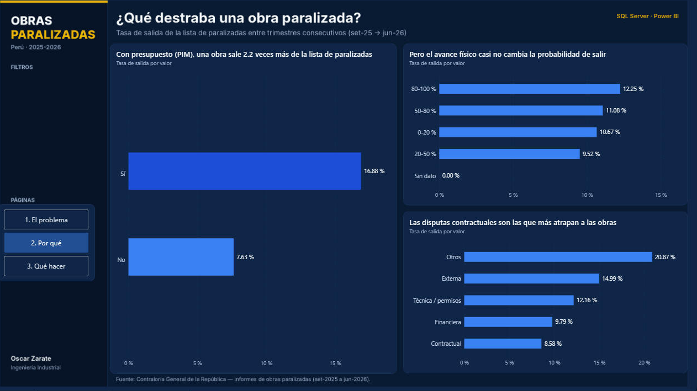
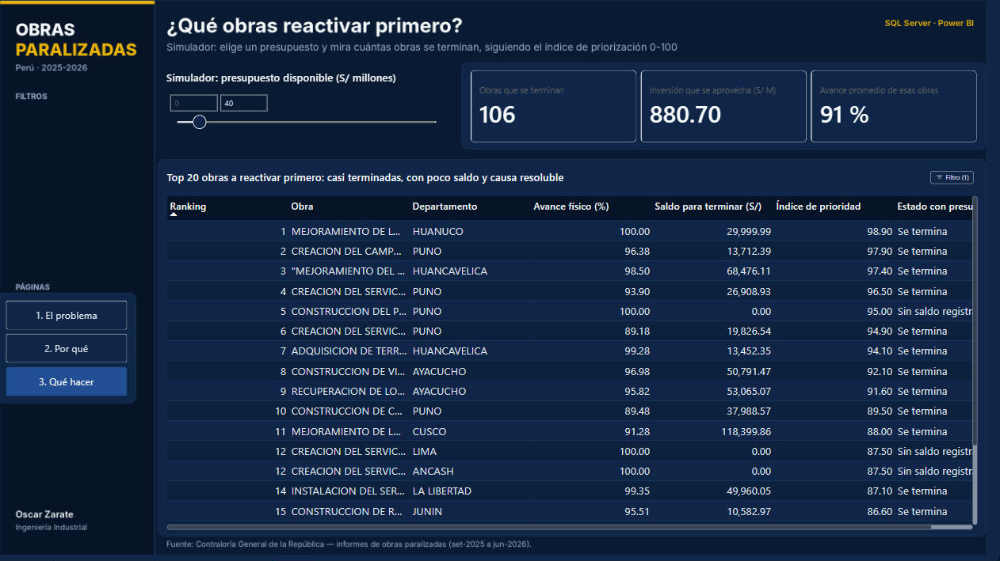

# ¿Por qué el Perú no termina sus obras?
Análisis de obras públicas paralizadas con **SQL Server** y **Power BI**, a partir de datos abiertos de la Contraloría General de la República (CGR).

**Autor:** Oscar Zarate · Ingeniería Industrial



---

## El problema
A junio de 2026 hay **2,262 obras públicas paralizadas** en el Perú, con **S/ 27.5 mil millones** de inversión todavía por ejecutar. La pregunta de gestión es: *¿qué tienen en común las obras que sí logran destrabarse, y cuáles conviene rescatar primero?*

## Resultados
- **9,134 registros** oficiales de 4 informes de la Contraloría, limpiados e integrados en un modelo estrella en SQL Server.
- **Hallazgo central:** con presupuesto asignado, una obra sale **2.2 veces más** de la lista de paralizadas.
- **Decisión:** con **S/ 40 millones** se terminan **106 obras** con 91 % de avance y se aprovechan **S/ 881 millones** ya invertidos (simulador en Power BI).
- **Producto:** dashboard de 3 páginas (problema → causas → decisión) con simulador de presupuesto y un plan de acción en 3 fases.

## Hallazgos principales
| # | Hallazgo |
|---|---|
| 1 | Con presupuesto asignado (PIM), el **16.9 %** de las obras sale de la lista de paralizadas al trimestre siguiente. Sin presupuesto, solo el **7.6 %**: **2.2 veces menos**. |
| 2 | El avance físico casi no influye en esa probabilidad (de **9.5 %** a **12.2 %** según el rango). Estar casi terminada no garantiza que la obra se reactive. |
| 3 | **2 de cada 3** obras paralizadas no tienen presupuesto asignado en 2026. |
| 4 | Las disputas contractuales son las que menos se resuelven (**8.6 %** de salida). |
| 5 | Siguiendo el índice de priorización, con **S/ 40 millones** se terminan **106 obras** con **91 %** de avance promedio, en las que ya se invirtieron **S/ 881 millones**. |
| 6 | La mitad de las obras necesita menos de **S/ 619 mil** para terminarse (mediana); el promedio, S/ 12.2 millones, lo inflan unas pocas megaobras. |

> **Limitación:** "salir de la lista" significa que la obra dejó de figurar como paralizada en el siguiente informe. Puede haberse reactivado, culminado o dado de baja, porque la CGR no indica el motivo. Los hallazgos son correlaciones, no causas probadas.

## Datos
- **Fuente:** CGR, *Informe de obras paralizadas en el territorio nacional*, con los anexos de la base de datos por obra.
- **Cortes:** setiembre 2025, diciembre 2025, marzo 2026 y junio 2026.
- **Volumen:** 9,134 registros. El formato cambió entre informes: 42 a 44 columnas antes de 2026 y 38 en junio 2026. Se estandarizó con `scripts/excel_a_csv.py`.

## Arquitectura
```
Excel CGR (4 cortes)
   │  scripts/excel_a_csv.py   (estandariza columnas)
   ▼
SQL Server
   ├─ stg.obras_raw            (datos crudos, todo texto)
   ├─ stg.vw_obras_limpias     (9 reglas de limpieza)
   └─ dw.*                     (modelo estrella)
        fact_obra_corte  ─┬─ dim_corte / dim_obra / dim_ubicacion
                          ├─ dim_entidad / dim_sector / dim_tipo_obra
                          └─ dim_causal (grupo y factor de resolución)
        vistas: vw_resumen_corte, vw_movimientos,
                vw_tasa_salida_por_factor, vw_indice_priorizacion
   ▼
Power BI (medidas DAX + dashboard de 3 páginas)
```

## Reglas de limpieza
1. Los valores `''`, `' '` y `'-'` pasan a NULL.
2. Texto en un campo numérico pasa a NULL (por ejemplo, "No declarado" en el año).
3. CUI = 0 pasa a NULL.
4. Las causales se separan en código y descripción, con mayúsculas y espacios unificados.
5. "Por Contrata" se unifica como "Contrata".
6. Los nombres de sector se unifican entre informes.
7. Costo de referencia = costo actualizado, o el costo del expediente técnico si el actualizado es 0.
8. Se marcan como sospechosos los registros con saldo de obra 0 y avance menor a 100 %.
9. La obra sin código Infobras ("Inventario 4") recibe un código sustituto.

## Índice de priorización (supuesto editable)
| Criterio | Peso |
|---|---|
| Avance físico | 40 % |
| Saldo pendiente bajo (percentil inverso) | 25 % |
| Causa resoluble (`dim_causal.factor_resolucion`) | 15 % |
| Tiene presupuesto (PIM) | 15 % |
| Está en la lista priorizada oficial (Ley 31589) | 5 % |

## Simulador de presupuesto (Power BI)
- Tabla `Presupuesto = GENERATESERIES(0, 500, 5)` (S/ millones) con un segmentador deslizante.
- Columna calculada `Saldo acumulado` en `vw_indice_priorizacion`: suma del saldo pendiente de las obras con mejor ranking (solo obras con saldo > 0).
- Medidas: `Obras que se terminan`, `Inversion destrabada S/ M`, `Avance promedio financiadas` y `Estado con presupuesto` (Se termina / Pendiente / Sin saldo registrado).

## Dashboard
| Página | Qué responde |
|---|---|
| 1. El problema | Cuántas obras, cuánto dinero, dónde, por qué y cómo evoluciona por trimestre |
| 2. Por qué | Qué factores se asocian a que una obra salga de la lista |
| 3. Qué hacer | Ranking de prioridad y simulador de presupuesto |




## Plan de acción (enfoque de gestión de proyectos)
1. **0-3 meses:** financiar las obras del índice que caben en el presupuesto disponible.
2. **3-9 meses:** mesa de solución de controversias para incumplimientos y arbitrajes.
3. **Continuo:** alerta temprana trimestral con el dashboard.

## Cómo reproducirlo
1. Copia `data/*.csv` a `C:\Users\Public\ObrasParalizadas\data\`.
2. Ejecuta en SSMS, en orden: `sql/01` → `sql/02` → `sql/03` → `sql/04` → `sql/05`. El script `00_parche_rendimiento.sql` es solo para SQL Server 2019+, en caso de lentitud.
3. Conecta Power BI a la base `ObrasParalizadas` e importa las tablas `dw.*`.
4. Opcional: aplica el tema `powerbi/Tema_ObrasParalizadas_v3.json` desde Diseño → Importar tema y usa los fondos de `powerbi/` como imagen al fondo de cada página.

## Herramientas
SQL Server 2025 · SSMS · Power BI Desktop · Python (pandas) · Excel
